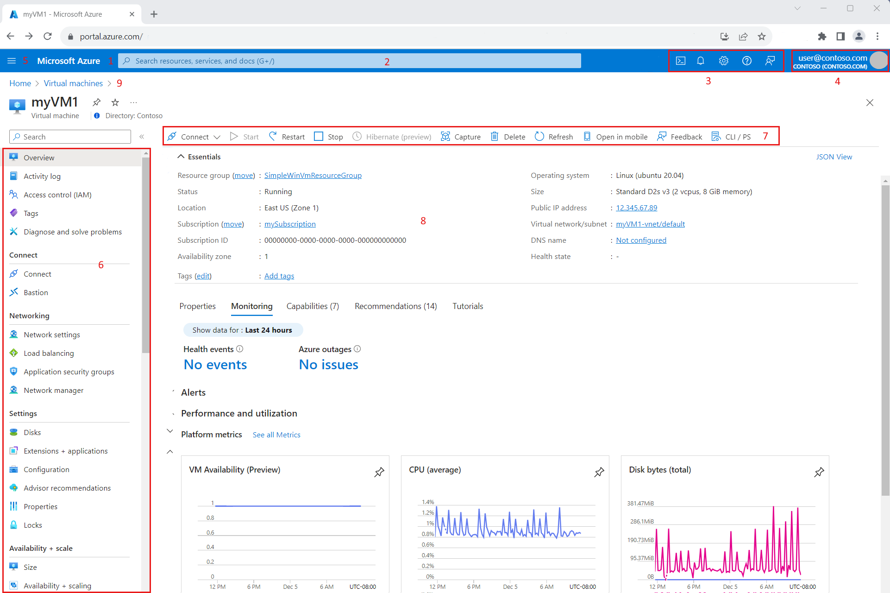
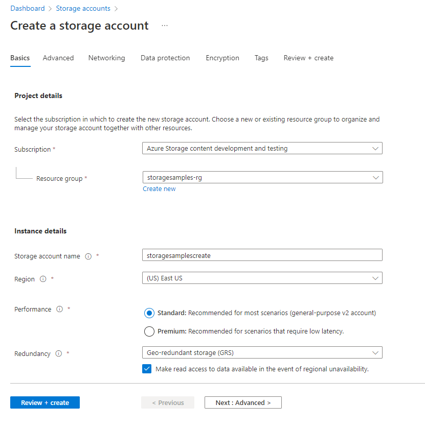
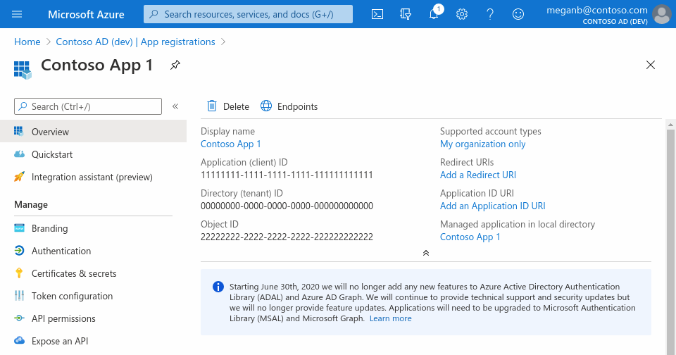
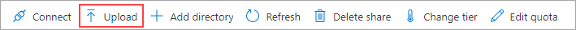
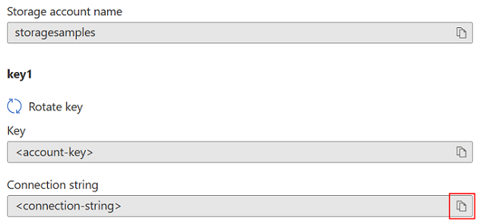
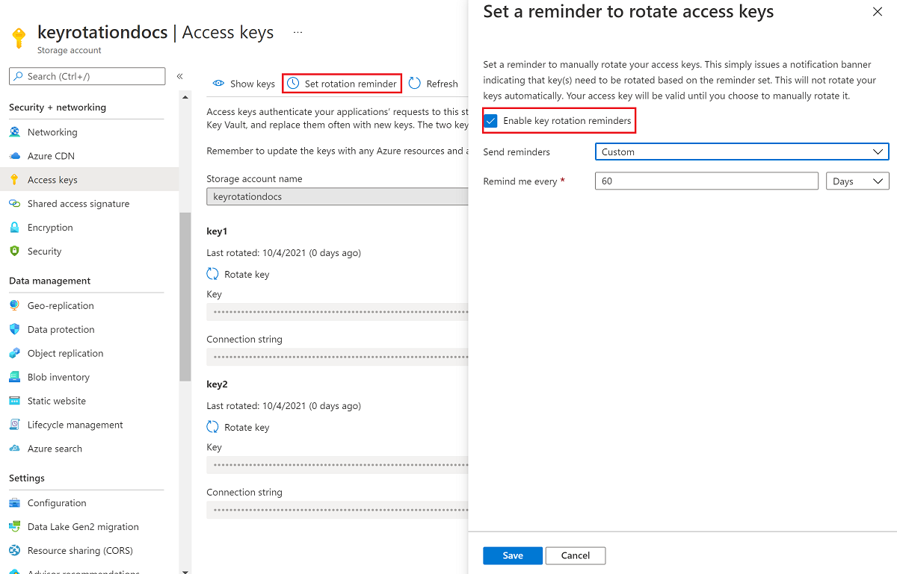

# Creating Azure App

## Overview

This guide walks you through creating an Azure Storage Account and File Share from scratch, enabling you to use the Azure File Service Extension with Krista. You'll learn how to set up the necessary Azure resources, configure security settings, and generate the required SAS token for authentication.

## Prerequisites

Before starting, ensure you have:

- **Azure Account**: Active Azure subscription with appropriate permissions
- **Resource Creation Rights**: Ability to create storage accounts and resource groups
- **Azure Portal Access**: Access to [Azure Portal](https://portal.azure.com)
- **Basic Azure Knowledge**: Familiarity with Azure resource management concepts

## Step-by-Step Instructions

### Step 1: Create Resource Group (Optional)

If you don't have an existing resource group, create one to organize your resources:

1. **Navigate to Resource Groups**:
   - Go to [Azure Portal](https://portal.azure.com)
   - Search for "Resource groups" in the top search bar
   - Click **Resource groups** from the results

2. **Create New Resource Group**:
   - Click **+ Create** button
   - Fill in the required information:
     - **Subscription**: Select your Azure subscription
     - **Resource group name**: Choose a descriptive name (e.g., `krista-azure-files-rg`)
     - **Region**: Select a region close to your users (e.g., `East US`, `West Europe`)
   - Click **Review + create**
   - Click **Create** to finish



### Step 2: Create Storage Account

1. **Navigate to Storage Accounts**:
   - In Azure Portal, search for "Storage accounts"
   - Click **Storage accounts** from the results
   - Click **+ Create** button

2. **Configure Basic Settings**:
   - **Subscription**: Select your Azure subscription
   - **Resource group**: Choose existing or create new resource group
   - **Storage account name**: Enter unique name (3-24 characters, lowercase letters and numbers only)
     - Example: `kristaafilestore2024`
     - Must be globally unique across all Azure storage accounts
   - **Region**: Select same region as your resource group
   - **Performance**: Select **Standard** (recommended for most use cases)
   - **Redundancy**: Choose based on your requirements:
     - **LRS (Locally Redundant Storage)**: Cost-effective, single datacenter
     - **GRS (Geo-Redundant Storage)**: Higher availability, cross-region replication



3. **Configure Advanced Settings** (Optional):
   - **Security**: 
     - ✅ Enable secure transfer required (HTTPS)
     - ✅ Enable blob public access (can be disabled for higher security)
   - **Data Lake Storage Gen2**: Leave disabled unless specifically needed
   - **Network Connectivity**: 
     - Select **Enable public access from all networks** for initial setup
     - Can be restricted later for enhanced security

4. **Review and Create**:
   - Click **Review + create**
   - Verify all settings are correct
   - Click **Create** to deploy the storage account
   - Wait for deployment to complete (usually 1-2 minutes)



### Step 3: Create File Share

1. **Navigate to Your Storage Account**:
   - Go to **Storage accounts** in Azure Portal
   - Click on your newly created storage account
   - In the left menu, find **Data storage** section

2. **Access File Shares**:
   - Click **File shares** under Data storage
   - Click **+ File share** button

3. **Configure File Share**:
   - **Name**: Enter file share name (3-63 characters, lowercase letters, numbers, hyphens)
     - Example: `documents`, `project-files`, `shared-data`
   - **Tier**: Select performance tier based on your needs:
     - **Transaction optimized**: Best for high transaction workloads
     - **Hot**: Frequently accessed data
     - **Cool**: Infrequently accessed data (lower storage cost)
   - **Quota**: Set maximum size (optional)
     - Leave blank for maximum available space
     - Set specific limit if needed (e.g., 100 GB)



4. **Create File Share**:
   - Click **Create** button
   - File share will be created immediately
   - You'll see it listed in the File shares section

### Step 4: Upload Sample Files (Optional)

To test the extension, upload some sample files:

1. **Access File Share**:
   - Click on your newly created file share
   - You'll see the file share browser interface

2. **Create Directory Structure**:
   - Click **+ Add directory** to create folders
   - Example structure:
     ```
     documents/
     ├── reports/
     ├── presentations/
     └── spreadsheets/
     ```

3. **Upload Files**:
   - Navigate to desired directory
   - Click **Upload** button
   - Select files from your computer
   - Click **Upload** to transfer files



### Step 5: Generate SAS Token

1. **Navigate to Shared Access Signature**:
   - In your storage account, go to **Security + networking**
   - Click **Shared access signature**

2. **Configure SAS Token Settings**:
   - **Allowed services**: ✅ File only
   - **Allowed resource types**: ✅ Service, ✅ Container, ✅ Object
   - **Allowed permissions**: ✅ Read, ✅ List
   - **Start time**: Current time (or slightly in the past)
   - **Expiry time**: Set appropriate expiration (30-90 days recommended)
   - **Allowed protocols**: HTTPS only
   - **Signing key**: Key1 or Key2



3. **Generate Token**:
   - Click **Generate SAS and connection string**
   - Copy the **SAS token** (starts with `?sv=`)
   - Store securely for extension configuration

## Verification

### Verify Storage Account Setup

1. **Check Storage Account Status**:
   - Storage account shows "Available" status
   - No deployment errors or warnings
   - All required services are enabled

2. **Verify File Share Access**:
   - File share is visible in the storage account
   - Can browse file share contents
   - Upload/download test files work correctly

3. **Test SAS Token**:
   - Token format is correct (starts with `?sv=`)
   - Token includes all required parameters
   - Token hasn't expired

### Test Connection with Extension

1. **Configure Extension**:
   - Use storage account name (without `.file.core.windows.net`)
   - Use exact file share name (case-sensitive)
   - Use complete SAS token including `?` prefix

2. **Test Connectivity**:
   - Extension validation passes
   - Connection test succeeds
   - Can list directories and files

## Next Steps

After successfully creating your Azure resources:

1. **Configure Extension**: Follow the [Extension Configuration](/pages/ExtensionConfiguration.md) guide
2. **Set Up Authentication**: Review [Authentication](/pages/authentication.md) for security best practices
3. **Test Operations**: Try the catalog requests:
   - [List Of Files](/pages/ListOfFiles.md)
   - [List Of Directories](/pages/ListOfDirectories.md)
   - [Get File](/pages/GetFile.md)

## Security Considerations

### Storage Account Security

- **Access Keys**: Keep storage account access keys secure and rotate regularly
- **Network Access**: Consider restricting network access to specific IP ranges
- **Encryption**: Ensure encryption at rest and in transit is enabled
- **Monitoring**: Enable Azure Storage logging and monitoring

### File Share Security

- **Access Control**: Use SAS tokens instead of storage account keys
- **Permissions**: Grant minimum required permissions (Read and List only)
- **Expiration**: Set appropriate token expiration times
- **Rotation**: Plan for regular token rotation

### Best Practices

- **Resource Naming**: Use consistent, descriptive naming conventions
- **Resource Groups**: Organize related resources in the same resource group
- **Tagging**: Apply tags for cost tracking and resource management
- **Backup**: Consider backup strategies for important data
- **Monitoring**: Set up alerts for unusual access patterns or errors

## Troubleshooting

### Common Issues

**"Storage account name already exists"**
- **Cause**: Storage account names must be globally unique
- **Resolution**: Try a different name with numbers or organization prefix

**"Cannot create file share"**
- **Cause**: Storage account not fully deployed or permissions issue
- **Resolution**: Wait for storage account deployment to complete, verify permissions

**"SAS token doesn't work"**
- **Cause**: Incorrect permissions or expired token
- **Resolution**: Regenerate token with correct settings, verify expiration date

### Resource Limits

- **Storage Account**: 250 storage accounts per region per subscription
- **File Share**: 100 TiB maximum size per file share
- **Files**: 1 TiB maximum size per file
- **Directories**: 10,000 directories per file share

## Cost Optimization

### Storage Costs

- **Performance Tiers**: Choose appropriate tier based on access patterns
- **Redundancy**: Select minimum required redundancy level
- **Lifecycle Management**: Implement policies to move data to cooler tiers

### Transaction Costs

- **SAS Tokens**: More cost-effective than OAuth for simple operations
- **Batch Operations**: Group multiple operations when possible
- **Caching**: Implement caching to reduce repeated API calls

## See Also

- [Extension Configuration](/pages/ExtensionConfiguration.md) - Configure the extension with your Azure resources
- [Authentication](/pages/authentication.md) - Detailed SAS token setup and security
- [List Of Files](/pages/ListOfFiles.md) - Test file listing operations
- [Get File](/pages/GetFile.md) - Test file download operations
