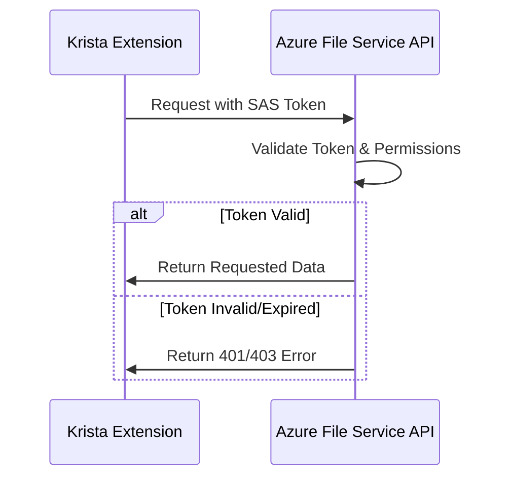
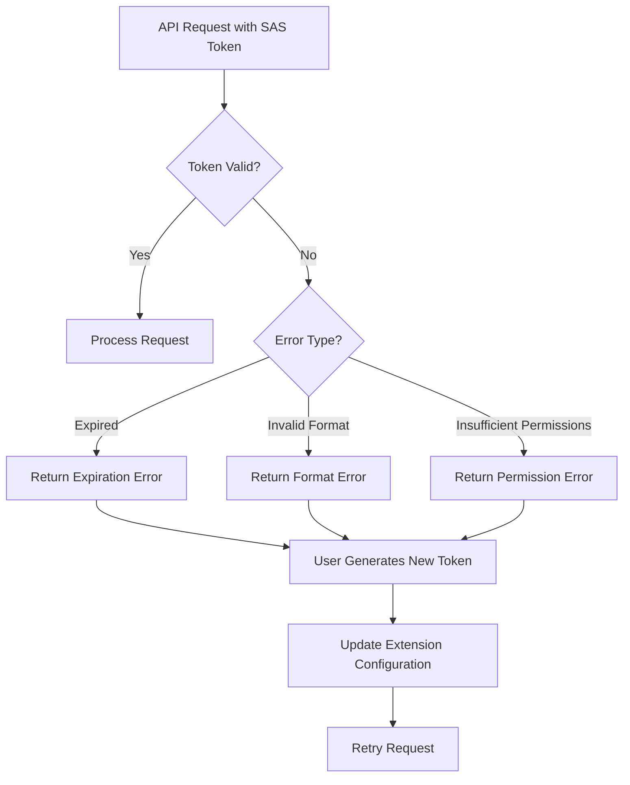

# Authentication

## Overview

The Azure File Service Extension uses **SAS Token authentication** to provide secure, time-limited access to Azure File Share resources. This authentication method eliminates the need to expose storage account keys while providing granular control over permissions and access duration.

## Authentication Modes

### SAS Token Authentication (Primary Method)

**✅ Fully Implemented & Tested**

Shared Access Signature (SAS) tokens provide secure, delegated access to Azure File Share resources without exposing your storage account keys. This is the recommended authentication method for production environments.

**When to Use SAS Token Authentication:**
- **Production Environments**: Secure access with controlled permissions
- **Time-Limited Access**: Tokens with specific expiration times
- **Third-Party Integration**: Safe credential sharing without exposing account keys
- **Granular Permissions**: Control exactly which operations are allowed
- **Compliance Requirements**: Auditable access with automatic expiration

### Alternative Authentication Methods

**⚠️ Note**: While OAuth 2.0 and Connection String authentication methods are implemented in the codebase, they are not currently used by the extension. **Use SAS Token authentication only** for all operations.

## OAuth 2.0 Scopes and Permissions

### Azure Storage Scopes

Although the extension uses SAS tokens rather than OAuth 2.0, understanding Azure Storage permissions is important for SAS token configuration:

**Required Scopes for SAS Token:**
- **`https://storage.azure.com/user_impersonation`** - Allows access to Azure Storage resources
- **File Service Access** - Specific to Azure File Service operations

**Permission Levels:**
- **Read (r)**: Required for downloading files and reading file metadata
- **List (l)**: Required for listing directories and files
- **Write (w)**: Not required for current extension operations
- **Delete (d)**: Not required for current extension operations

**Why Alternative Scopes Are Not Used:**
- **`https://storage.azure.com/.default`**: Too broad, grants unnecessary permissions
- **Storage account key access**: Security risk, not recommended for production
- **Blob-specific scopes**: Not applicable to File Share operations

## OAuth 2.0 Grant Types

### SAS Token Grant (Primary Method)

**Grant Type**: `sas_token`
**Used For**: Direct authentication to Azure File Share resources
**Flow**: Direct token-based access without OAuth 2.0 redirect flow

**Request Example**:
```http
GET https://{account}.file.core.windows.net/{share}/{path}?{sas_token}
Authorization: Not required (token in URL)
```

**Response Example**:
```json
{
  "status": "success",
  "data": {
    "files": ["file1.pdf", "file2.docx"],
    "directories": ["folder1", "folder2"]
  }
}
```

### Alternative Grant Types (Not Currently Used)

#### Authorization Code Grant
**Grant Type**: `authorization_code`
**Used For**: Initial OAuth 2.0 authentication (not implemented in extension)
**Status**: Available in codebase but not used

#### Client Credentials Grant
**Grant Type**: `client_credentials`
**Used For**: Service-to-service authentication (not implemented in extension)
**Status**: Available in codebase but not used

## Authentication Flow

### SAS Token Authentication Flow

The Azure File Service Extension uses a simplified authentication flow with SAS tokens:

1. **Token Generation**: Administrator generates SAS token in Azure Portal
2. **Configuration**: Token is configured in Krista extension settings
3. **Request Authentication**: Each API request includes the SAS token
4. **Azure Validation**: Azure validates token permissions and expiration
5. **Resource Access**: If valid, Azure grants access to requested resources

**Step-by-Step Flow**:



### Token Storage Mechanism

- **Storage Location**: Krista platform configuration (encrypted)
- **Access Control**: Limited to extension execution context
- **Transmission**: HTTPS only, token included in query parameters
- **Caching**: No local token caching (retrieved from config per request)

## Token Management

### Access Token Expiration

**SAS Token Lifetime**:
- **Configurable Duration**: Set during token generation (1 hour to 1 year)
- **Recommended Duration**: 1-30 days for production environments
- **Maximum Duration**: Up to 1 year (not recommended for security)

**Token Expiration Handling**:
- **Automatic Detection**: Extension detects expired tokens (HTTP 403 responses)
- **Error Response**: User-friendly error messages for expired tokens
- **Manual Renewal**: Administrator must generate new token before expiration
- **No Auto-Refresh**: SAS tokens cannot be automatically refreshed

### Refresh Token Management

**⚠️ Important**: SAS tokens do not use refresh tokens. Unlike OAuth 2.0 flows, SAS tokens are standalone and cannot be refreshed.

**Token Renewal Process**:
1. **Monitor Expiration**: Track token expiration dates
2. **Generate New Token**: Create new SAS token before expiration
3. **Update Configuration**: Replace old token in extension configuration
4. **Validate New Token**: Test connectivity with new token

### Re-authentication Scenarios

**When Re-authentication is Required**:
- **Token Expiration**: SAS token reaches expiration date
- **Permission Changes**: Required permissions modified in Azure
- **Security Rotation**: Regular security token rotation
- **Account Key Rotation**: If SAS token was signed with rotated account key

## Token Expiration Scenarios

### Access Token Expiration Handling

**Scenario 1: Token Expired**
- **Cause**: SAS token past expiration date
- **Detection**: HTTP 403 Forbidden responses from Azure
- **Error Message**: "The SAS token has expired. Please generate a new token."
- **Resolution**: Generate new SAS token and update configuration

**Scenario 2: Invalid Permissions**
- **Cause**: SAS token lacks required permissions (Read/List)
- **Detection**: HTTP 403 Forbidden responses for specific operations
- **Error Message**: "Insufficient permissions. Ensure Read and List permissions are granted."
- **Resolution**: Generate new SAS token with correct permissions

**Scenario 3: Invalid Token Format**
- **Cause**: Malformed or incomplete SAS token
- **Detection**: HTTP 400 Bad Request or authentication errors
- **Error Message**: "Invalid SAS token format. Please verify the token is complete."
- **Resolution**: Regenerate and recopy complete SAS token

### Token Revocation Scenarios

**Manual Revocation**:
- **Storage Account Key Rotation**: Invalidates all SAS tokens signed with old key
- **Token Deletion**: No direct deletion, but new tokens can be generated
- **Account Access Changes**: Modifying storage account access policies

**Automatic Revocation**:
- **Expiration Time**: Tokens automatically invalid after expiration
- **Permission Changes**: Azure policy changes may affect token validity
- **Account Suspension**: Storage account suspension invalidates all tokens

### Expiration Handling Flow



## Security Best Practices

### SAS Token Security

1. **Principle of Least Privilege**
   - Grant only Read (r) and List (l) permissions
   - Avoid Write (w) and Delete (d) permissions unless required
   - Limit to File service only (ss=f parameter)

2. **Time-Based Security**
   - **Short Expiration**: Use shortest practical expiration time
   - **Production Recommendation**: 1-30 days maximum
   - **Development/Testing**: 1-7 days maximum
   - **Emergency Access**: 1-24 hours for temporary access

3. **Network Security**
   - **HTTPS Only**: Always enforce HTTPS protocol (spr=https)
   - **IP Restrictions**: Limit access to specific IP ranges when possible
   - **Regional Restrictions**: Consider geographic access limitations

4. **Token Management**
   - **Secure Storage**: Store tokens in encrypted configuration systems
   - **Regular Rotation**: Establish token rotation schedule
   - **Access Logging**: Monitor token usage and access patterns
   - **Incident Response**: Have procedures for token compromise

### Access Control Best Practices

1. **Resource Scope Limitation**
   - **File Share Level**: Limit SAS token to specific File Share only
   - **Directory Level**: Consider directory-level SAS tokens for sensitive data
   - **Service Level**: Ensure token is limited to File service (not Blob/Queue/Table)

2. **Permission Granularity**
   - **Read Permission**: Required for file downloads and metadata access
   - **List Permission**: Required for directory browsing and file listing
   - **Avoid Unnecessary Permissions**: Don't grant Write/Delete unless required

3. **Monitoring and Auditing**
   - **Access Logs**: Enable Azure Storage logging for audit trails
   - **Usage Monitoring**: Track token usage patterns for anomalies
   - **Error Monitoring**: Monitor authentication failures for security events

## Troubleshooting Authentication

### Common Authentication Issues

#### Invalid SAS Token Format
**Symptoms**: HTTP 400 Bad Request or "Invalid authentication" errors
**Causes**:
- Token missing "?" prefix
- Incomplete token (copy/paste errors)
- URL encoding issues
- Extra characters or spaces

**Resolution**:
1. Ensure token starts with `?sv=`
2. Copy complete token from Azure Portal
3. Verify no extra spaces or characters
4. Check URL encoding is correct

#### Token Expired
**Symptoms**: HTTP 403 Forbidden with "Server failed to authenticate" message
**Causes**:
- SAS token past expiration date (se parameter)
- Token not yet valid (st parameter in future)
- Clock synchronization issues

**Resolution**:
1. Check current date/time against token expiration
2. Generate new SAS token with future expiration
3. Update extension configuration with new token
4. Verify system clock synchronization

#### Insufficient Permissions
**Symptoms**: HTTP 403 Forbidden for specific operations
**Causes**:
- Missing Read permission for file downloads
- Missing List permission for directory operations
- Wrong resource types selected
- File service not included in token

**Resolution**:
1. Regenerate SAS token with Read and List permissions
2. Ensure Service, Container, and Object resource types are selected
3. Verify File service is included (ss=f parameter)
4. Test token with simple directory listing

#### Wrong Storage Account or File Share
**Symptoms**: HTTP 404 Not Found or "Resource not found" errors
**Causes**:
- Incorrect storage account name in configuration
- File share name doesn't exist
- File share in different storage account
- Typos in configuration parameters

**Resolution**:
1. Verify storage account name in Azure Portal
2. Check File Share exists and is accessible
3. Ensure exact spelling (case-sensitive)
4. Test with Azure Storage Explorer for verification

#### Network and Connectivity Issues
**Symptoms**: Timeout errors or connection failures
**Causes**:
- Network connectivity problems
- Azure service outages
- Firewall blocking HTTPS traffic
- DNS resolution issues

**Resolution**:
1. Test network connectivity to Azure
2. Check Azure service status
3. Verify firewall allows HTTPS (port 443)
4. Test DNS resolution for storage account

### Advanced Troubleshooting

#### Token Validation Testing
```bash
# Test SAS token with curl (replace with your values)
curl -I "https://mystorageaccount.file.core.windows.net/myfileshare?restype=share&{sas_token}"
```

#### Common Error Codes
- **HTTP 400**: Invalid request format or malformed SAS token
- **HTTP 401**: Authentication required (missing or invalid token)
- **HTTP 403**: Forbidden (expired token or insufficient permissions)
- **HTTP 404**: Resource not found (wrong account/share name)
- **HTTP 500**: Azure service error (temporary issue)

#### Logging and Diagnostics
1. **Enable Extension Logging**: Check Krista logs for detailed error messages
2. **Azure Storage Logs**: Enable storage account logging for audit trails
3. **Network Tracing**: Use network tools to diagnose connectivity issues
4. **Token Analysis**: Decode SAS token parameters to verify configuration

## See Also

- [Extension Configuration](/pages/ExtensionConfiguration.md) - Complete setup guide
- [Creating Azure App](/pages/CreatingAzureApp.md) - Azure Storage Account setup
- [Security Best Practices](/pages/ExtensionConfiguration.md#security-considerations) - Additional security guidance
- [Azure Storage Documentation](https://docs.microsoft.com/en-us/azure/storage/) - Official Azure documentation
